# Agentic SDLC harness

**A mechanism, not a feature.** A requirement goes in; a reviewed, traced, merge-ready draft PR
comes out. Humans act only at approval gates (after Specify, after Architect / after Review,
before merge). Agents never merge, approve, or move a ticket past ready-for-review.

The harness is repo-agnostic: everything it knows about a product repository is in one
`harness.yaml` contract (build/test/lint commands, requirement-id pattern, protected paths,
safety classification, where the governing standards live, instruction files, permission
boundaries, layer visibility). Devin is the orchestrator, the main agent and every stage
sub-agent (one child session per stage attempt, v3 REST API).

```mermaid
flowchart LR
  REQ([Requirement]) --> SPEC[Specify]
  SPEC -- questions Q-SPEC-n --> H1{{Human: answer / approve}}
  H1 -->|gate:approved| DEC[Decompose]
  DEC --> DES[Design]
  DES --> ARC[Architect]
  ARC -- VIOLATION ≤2 --> DES
  ARC -- CONFIRMED --> H2{{Human gate: after-architect}}
  H2 -->|approved| COD[Coding<br/>test first, agent branch]
  COD --> VER[Deterministic checks<br/>model/logic · removed guards · missing→0 · scope · governance]
  VER -- FAIL --> COD
  VER -- PASS --> QA[QA<br/>different mode, own oracle]
  QA -- FAIL ≤2 --> COD
  QA -- PASS --> INT[Integrate]
  INT --> DOC[Document] --> TR[Trace]
  TR --> H3{{Human gate: before-merge<br/>2 reviewers on protected paths}}
  H3 -->|approved| PR([Draft PR, ready for review])
  classDef human fill:#f1ebfd,stroke:#6941c6
  class H1,H2,H3 human
```



RCA chain: `Explore ⇄ Evaluate (evidence-only, no code access, ≤2 rounds → RETRACTION) → Review →
human gate → Fix → checks → QA → Integrate → Document → Trace → human gate`.
Full diagram with both chains: [`docs/flowchart.html`](docs/flowchart.html) / [`docs/flowchart-feature.png`](docs/flowchart-feature.png), [`docs/flowchart-rca.png`](docs/flowchart-rca.png).

## What is in the box

| Path | Purpose |
|------|---------|
| `harness/agentic_sdlc/orchestrator.py` | Persisted state machine: feature + RCA plans, bounded loops, dependency waves, pause/resume at gates, questions and missing standards |
| `harness/agentic_sdlc/config.py` | `harness.yaml` repo contract; enforces QA mode ≠ Coding mode and Evaluate = evidence-only |
| `harness/agentic_sdlc/standards.py` | Runtime standards store (`standards/*.md` now, Confluence provider pluggable). Missing standard ⇒ `BLOCKED`, never assumed |
| `harness/agentic_sdlc/brief.py` | Compiles the self-contained stage brief: role, prepare/execute/verify/deliver, standards, boundaries, prior artifacts, loop feedback, structured-output schema |
| `harness/agentic_sdlc/sessions/` | `rest_v3` (Devin v3 API), `relay` (parent Devin session creates the child), `fake` (scripted, for tests/CI) |
| `harness/agentic_sdlc/gates.py` | GitHub-native gates: gate issue + `gate:approved`/`gate:rejected` labels by a **User** actor; PR-review gate for before-merge; file gate offline. Jira/Linear are optional adapters, not dependencies |
| `harness/agentic_sdlc/checks/` | Deterministic checks wired into the Coding loop: `model_logic_separation`, `removed_error_handling`, `missing_input_as_zero`, scope, governance |
| `harness/agentic_sdlc/runlog.py` | Append-only, hash-chained JSONL audit log + `replay()` |
| `harness/agentic_sdlc/trace.py`, `kpis.py` | Incremental requirement → design → code → test → PR matrix; per-run KPIs + `runs/kpi_history.jsonl` trend |
| `plugin/skills/` | `CONTRACT.md` + 14 stage skills (Specify, Decompose, Design, Architect, Coding, QA, Integrate, Document, Trace, Release, Explore, Evaluate, Review, Fix) |
| `standards/` | Governing standards stand-in (STD-REQ, STD-ARCH, STD-CODE, STD-SAFETY, STD-QA, STD-GOV, STD-DOC, STD-RCA) |
| `console/` | Vite/React run console over the audit log: Runs, Run view (timeline, gates, loops, drawer), Trace, Audit (chain re-verified in the browser), KPIs + trend, Gate decision form |
| `console/tests/ui/` | 7 Playwright journeys ([plan](tests/ui/UI_TEST_PLAN.md)); run in CI on every push |
| `runs/` | Worked examples: audit logs, trace, KPIs for each recorded run |
| `examples/targets/adms/` | Repo contract for the public ADMS fixture, a requirement and a defect report |
| `docs/IMPLEMENTATION_PLAN.md` | The plan this was built from |

## Run it

```bash
pip install -e '.[dev]' && pytest -q                     # Python core
harness run --workflow feature --config examples/targets/adms/harness.yaml \
  --requirement examples/targets/adms/requirements/REQ-tie-capacity.md --backend rest_v3
harness status <run-id>; harness answer <run-id> Q-SPEC-1 --actor <login> --text "..."
harness resume <run-id>                                  # after a gate label / session result lands
harness replay <run-id>                                  # verify the chain, rebuild state from the log
harness check --diff change.diff --brief-files backend/app/flisr.py   # deterministic checks alone
harness export && npm --prefix console run dev           # console on :5173
npx --prefix console playwright test                     # UI gauntlet (builds + serves on :4173)
```

`rest_v3` needs `DEVIN_API_KEY` and `DEVIN_ORG_ID` (`https://api.devin.ai/v3`, never v1). `relay`
writes `runs/<id>/sessions/<stage>.request.json` and pauses; whoever drives the parent session
creates the child and drops the `.result.json` back. `fake` replays a scripted file.

## Governance invariants (enforced, not advised)

* Branch prefix `agent/`, draft PRs only, `ai-generated` label, `AI-Governance: run=… stage=… agent=… model=…` trailer on every commit — checked by `checks.governance`.
* Gate decisions come from a human account in the system of record; bot actors are ignored; silence is never approval.
* Protected paths and safety-critical classification require two human approving reviews before the before-merge gate opens.
* Evaluate receives only the evidence package: `repos=[]`, boundary `forbidden: **`, cannot be overridden by config.
* Loops are bounded by the contract (`loops.architect|qa|rca`); hitting the bound ⇒ `NEEDS-HUMAN` with history.
* Missing or invalid input is never coerced to zero — flagged by the deterministic check unless the line carries `# harness: zero-ok <clause>`.

See [`DEMO_NOTES.md`](DEMO_NOTES.md) for the dry-run narrative and the customer-ask → location map.
