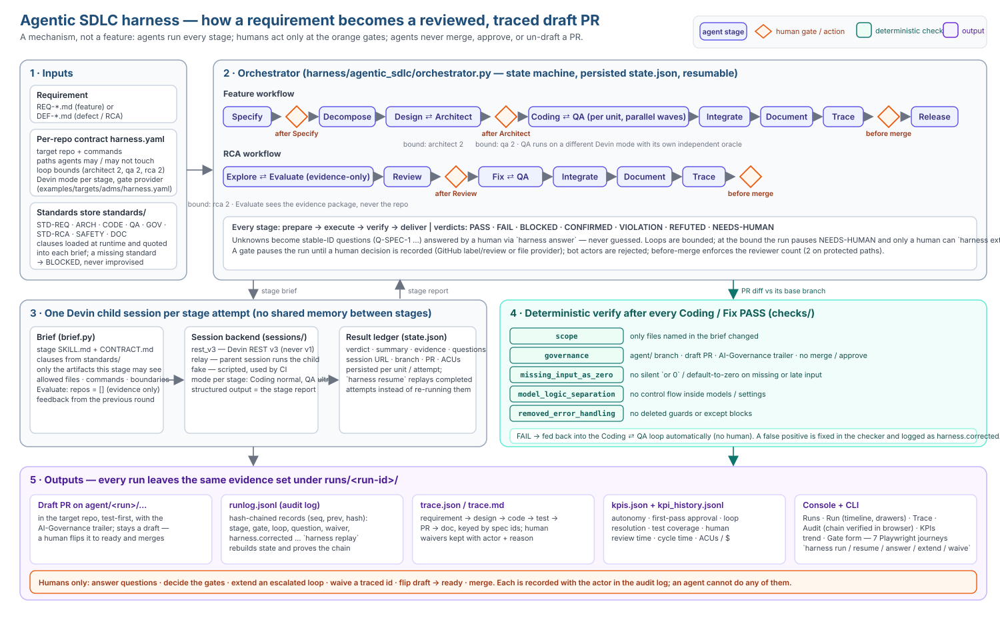

# Architecture

The harness is a **mechanism, not a feature**: a requirement goes in, a reviewed, traced, draft PR comes out, and humans act only at explicit gates. It is repo-agnostic — the target repository, its rules and its loop bounds are all configuration.

## The five layers in the diagram

| # | Layer | What it is | Where |
|---|-------|------------|-------|
| 1 | **Inputs** | A requirement (`REQ-*.md`) or defect (`DEF-*.md`), a per-repo contract (`harness.yaml`: repo, commands, paths agents may touch, loop bounds, Devin mode per stage, gate provider) and the standards store. Standards are loaded at run time and quoted into every brief; a missing standard stops the run as `BLOCKED` rather than being improvised. | `standards/`, `examples/targets/adms/harness.yaml` |
| 2 | **Orchestrator** | A persisted state machine that walks the Feature or RCA plan stage by stage, runs the bounded loops (Design⇄Architect, Coding⇄QA, Explore⇄Evaluate, Fix⇄QA), pauses at gates and on `NEEDS-HUMAN`, and resumes from `state.json` without re-running completed work. | `harness/agentic_sdlc/orchestrator.py`, `cli.py` |
| 3 | **Stage sessions** | Every stage attempt is its own Devin child session with no shared memory. `brief.py` assembles the skill, the contract, the relevant standards clauses and *only* the artifacts that stage may see (Evaluate gets evidence, not the repo). A pluggable backend (`rest_v3`, `relay`, `fake`) runs the session; its structured output is the stage report, ledgered per unit/attempt. | `brief.py`, `sessions/`, `plugin/skills/*/SKILL.md` |
| 4 | **Deterministic checks** | After every Coding/Fix `PASS`, the PR diff (against its real base branch) is checked for scope, governance (agent/ branch, draft PR, governance trailer, no merge/approve), missing-input-as-zero, model/logic separation and removed error handling. A `FAIL` is fed straight back into the loop; no human is involved. | `harness/agentic_sdlc/checks/` |
| 5 | **Outputs** | A draft PR in the target repo; a hash-chained audit log (`runlog.jsonl`); a requirement→design→code→test→PR→doc trace matrix with human waivers; KPIs and KPI history; and a static console (Runs, Run, Trace, Audit, KPIs, Gate). | `runs/<run-id>/`, `console/` |

## What a run looks like

**Feature:** Specify → *gate* → Decompose → Design⇄Architect → *gate* → Coding⇄QA (per unit, parallel waves) → Integrate → Document → Trace → *gate* → Release.

**RCA:** Explore⇄Evaluate → Review → *gate* → Fix⇄QA → Integrate → Document → Trace → *gate*.

Each stage follows the same contract — `prepare → execute → verify → deliver` — and ends in one verdict (`PASS`, `FAIL`, `BLOCKED`, `CONFIRMED`, `VIOLATION`, `REFUTED`, `NEEDS-HUMAN`). Anything the agent does not know becomes a stable-ID question (`Q-SPEC-1 …`) that a human answers with `harness answer`; nothing is guessed.

## Where humans are, and only humans

| Human action | CLI / UI | Recorded as |
|--------------|----------|-------------|
| Decide a gate (after Specify, after Architect, after Review, before merge) | GitHub label/review or gate form | `gate.decided` with actor; bot actors rejected; before-merge enforces the reviewer count |
| Answer a stage question | `harness answer` | `question.answered` |
| Extend a loop that hit its bound | `harness extend` | `loop.extended` with actor + reason |
| Waive a trace requirement | `harness waive` | `trace.waived` with actor + reason |
| Flip draft → ready, merge | GitHub | not available to agents |

Agents work only on `agent/` branches and draft PRs. The governance check rejects any merge, approval or draft→ready flip made by an agent, and the audit log's hash chain (`harness replay`) proves nothing was altered after the fact.

## Independence and bounds

- **QA is independent of Coding**: a different Devin mode (`coding: normal`, `qa: ultra`), its own oracle, and no memory of how the code was written.
- **Evaluate is evidence-only**: it never has codebase access, so it judges Explore's hypothesis on the evidence package alone.
- **Loops are bounded** (`architect`, `qa`, `rca` in `harness.yaml`). On the bound the run stops `NEEDS-HUMAN`; only a human can extend it, and each extension is logged.

## Reading the evidence

- `runs/<run-id>/state.json` — current stage, stage results per unit/attempt, open questions, gate decisions.
- `runs/<run-id>/runlog.jsonl` — the audit log; `harness replay <run-id>` verifies the chain.
- `runs/<run-id>/trace.json` / `trace.md` — coverage per requirement id, including waivers.
- `runs/<run-id>/kpis.json`, `runs/kpi_history.jsonl` — per-run and trend KPIs (`harness kpis`).
- Console: `npm --prefix console run dev`, then `#/runs`.

See [`DEMO_NOTES.md`](../DEMO_NOTES.md) for the two live dry runs (feature `REQ-tie-capacity`, RCA `DEF-FLISR-7`) and the ask→location map.
